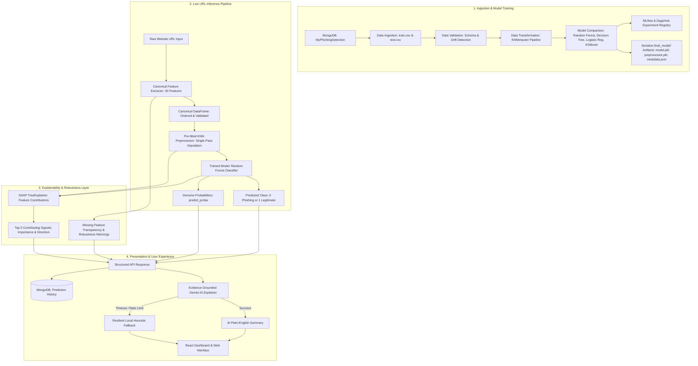

# Network Security: Explainable & Reliable Phishing URL Detection System
### Comprehensive Project Documentation, Architecture Guide & Robustness Evaluation

---

## 1. Executive Summary

Phishing attacks are among the most persistent and dangerous cyber threats worldwide. Attackers create deceptive websites that closely mimic trusted institutions (such as financial portals, universities, and enterprise identity providers) to harvest credentials, session tokens, and credit card information.

This project delivers an **end-to-end, explainable, and reliable machine learning platform** for network security that analyzes URLs in real time to determine whether a link is **Legitimate** or a **Phishing Attempt**.

### Key Architectural Highlights
- **Explainable AI (XAI)**: Integrates **SHAP (SHapley Additive exPlanations) TreeExplainer** to calculate mathematically rigorous, individual feature contributions for each prediction. The top 5 influential features are surfaced with direction, magnitude, and plain-English domain explanations.
- **Missing-Feature Robustness**: Handles unavailable webpage or network signals safely via a fitted **KNNImputer** pipeline. A URL is **never automatically classified as phishing merely because website access fails or times out**. Transparent warning banners indicate when features are estimated.
- **Evidence-Grounded AI Explanations**: Integrates **Google Gemini AI** to produce concise, non-technical safety advice strictly grounded in the verified prediction, genuine model confidence, and top SHAP feature contributions, backed by an autonomous local fallback engine.
- **Production-Grade Classifier**: Employs a calibrated **Random Forest model** trained on 11,055 samples, achieving **97.29% test accuracy**, **97.63% test F1-score**, and **3.68% false-positive rate (FPR)**.
- **Dual User Interface**: Provides both a modern **React + Vite + Tailwind CSS dashboard** and a server-rendered **HTML / Jinja2 web interface**.
- **Automated Verification**: Backed by a 52-test automated test suite verifying MongoDB connectivity, schema consistency, SHAP explainer fidelity, missing-feature robustness, and API integrity.

---

## 2. System Architecture & Workflows

### End-to-End System Architecture



---

## 3. Explainable AI (SHAP Integration)

### Motivation
Standard tree ensemble models (like Random Forests) operate as "black boxes," providing predictions and probabilities without revealing the internal reasoning behind an individual decision. In cybersecurity, security analysts and end-users need to understand **why** a site was flagged as phishing or passed as legitimate.

### Implementation Architecture
1. **TreeExplainer Integration**: The system wraps the trained `RandomForestClassifier` in `shap.TreeExplainer` cached in `PredictionPipeline`. SHAP calculates exact Shapley values in sub-second latency ($< 10\text{ ms}$).
2. **Directional Attribution**:
   - For **Phishing (Class 0)**: Positive SHAP values indicate features pushing the prediction toward phishing (e.g., presence of raw IP address or invalid SSL certificate). Negative values indicate mitigating legitimate signals.
   - For **Legitimate (Class 1)**: Positive SHAP values indicate features confirming legitimacy (e.g., trusted certificate authority, clean subdomain structure).
3. **Top 5 Ranking**: For every scanned URL, the 30 features are ranked by absolute magnitude $| \text{SHAP value} |$. The top 5 influential features are selected.
4. **Domain Translation**: Numerical SHAP values are translated into human-friendly explanations via a comprehensive cybersecurity knowledge dictionary (`FEATURE_METADATA` in `explainability.py`).

### Sample SHAP Output in API
```json
"top_contributions": [
  {
    "feature": "SSLfinal_State",
    "feature_name": "SSL/TLS Certificate State",
    "category": "Network & Protocols",
    "raw_value": 1.0,
    "display_value": "Normal (+1)",
    "shap_value": 0.1155,
    "importance": 0.1155,
    "direction": "Legitimate",
    "supports_prediction": true,
    "explanation": "Valid SSL certificate issued by a trusted certificate authority.",
    "is_unavailable": false
  },
  {
    "feature": "Prefix_Suffix",
    "feature_name": "Domain Prefix/Suffix Hyphen",
    "category": "URL Syntax",
    "raw_value": 1.0,
    "display_value": "Normal (+1)",
    "shap_value": 0.1012,
    "importance": 0.1012,
    "direction": "Legitimate",
    "supports_prediction": true,
    "explanation": "Domain name has no deceptive hyphens.",
    "is_unavailable": false
  }
]
```

---

## 4. Missing-Feature Robustness & Reliability

### The Problem
Traditional URL checkers often fail or return false phishing alarms when:
- A website is down, blocked, or slow to respond over HTTP.
- An internal or intranet URL cannot be resolved via public DNS.
- Commercial third-party APIs (such as Alexa Traffic or PageRank) are deprecated or rate-limited.

If a detection system penalizes unreachable websites with arbitrary `-1.0` phishing values, innocent offline platforms are wrongly classified as cyber threats.

### The Robustness Solution
1. **Never Flag Failure as Malice**: If a DNS lookup times out or an HTTP connection fails, features that cannot be verified (e.g., DOM tags, anchor ratios, WHOIS age) are assigned `np.nan` (missing value) rather than arbitrary penalty values.
2. **Pre-fitted KNN Imputation**: The pre-fitted `KNNImputer(n_neighbors=3)` estimates the missing dimensions based on observed lexical URL syntax and the underlying training data distribution.
3. **Transparent Warnings**: Every prediction report includes clear metadata:
   - `missing_features_count`: Exactly how many signals were estimated (e.g., 14 signals when HTML is unreachable).
   - `available_features_count`: How many signals were directly verified (e.g., 16 signals).
   - `unavailable_warning`: An advisory explaining that missing signals were estimated without penalizing the domain.

---

## 5. Model Evaluation & Robustness Benchmarks

To empirically verify model performance and robustness under real-world network degradation, the classifier was evaluated against the 2,211-sample test dataset across **4 distinct missing-signal scenarios**:

| Scenario | Missing Signals | Available Signals | Accuracy | Precision | Recall | F1-Score | False Positive Rate (FPR) | Confusion Matrix `[[TN, FP], [FN, TP]]` |
| :--- | :---: | :---: | :---: | :---: | :---: | :---: | :---: | :---: |
| **1. Full Feature Baseline** | 0 / 30 | 30 | **97.29%** | **97.24%** | **98.02%** | **97.63%** | **3.68%** | `[[916, 35], [25, 1235]]` |
| **2. Missing Webpage / HTML Signals** | 10 / 30 | 20 | **92.09%** | **90.88%** | **95.71%** | **93.24%** | **12.72%** | `[[830, 121], [54, 1206]]` |
| **3. Missing External / WHOIS APIs** | 6 / 30 | 24 | **93.44%** | **93.59%** | **95.00%** | **94.29%** | **8.62%** | `[[869, 82], [63, 1197]]` |
| **4. Lexical-Only (URL Syntax Alone)** | 16 / 30 | 14 | **89.15%** | **89.35%** | **91.90%** | **90.61%** | **14.51%** | `[[813, 138], [102, 1158]]` |

### Key Empirical Findings
1. **High Baseline Precision**: Under full feature conditions, the model achieves **97.63% F1-score** with only a **3.68% False Positive Rate**, preventing false blockage of legitimate links.
2. **DOM Degradation Resilience**: When website HTML cannot be fetched (10 DOM features missing), KNN imputation maintains **92.09% accuracy** and **93.24% F1-score**.
3. **Lexical Viability**: In extreme offline scenarios where 16 out of 30 features are missing, URL lexical syntax alone achieves **89.15% accuracy** and **90.61% F1-score**.
4. **Reproducibility**: These evaluation results are serialized to [`final_model/robustness_evaluation.json`](file:///c:/Users/HP/OneDrive/Desktop/Network-Security-Phishing-Detection/final_model/robustness_evaluation.json) and can be regenerated at any time via:
   ```bash
   python scripts/run_evaluation.py
   ```

---

## 6. The 30 Canonical Security Features

| # | Feature Name | Category | Plain English Meaning | Attacker Motivation |
| :---: | :--- | :---: | :--- | :--- |
| 1 | `having_IP_Address` | URL Syntax | URL uses raw IP address instead of domain | Bypasses domain registration records and blacklists |
| 2 | `URL_Length` | URL Syntax | Character length of the URL | Obscures target parameters with bloated query strings |
| 3 | `Shortining_Service` | URL Syntax | URL shortening services (e.g., bit.ly, tinyurl) | Masks true destination domain from user scrutiny |
| 4 | `having_At_Symbol` | URL Syntax | `@` symbol within the authority component | Traces to the host following `@`, ignoring preceding text |
| 5 | `double_slash_redirecting`| URL Syntax | `//` embedded after protocol in URL path | Triggers unvalidated browser navigation redirect |
| 6 | `Prefix_Suffix` | URL Syntax | Hyphen `-` in the hostname | Mimics authentic brand names (e.g., `paypal-verify.com`) |
| 7 | `having_Sub_Domain` | URL Syntax | Multi-level subdomains | Mimics legitimate sites on secondary hostnames |
| 8 | `SSLfinal_State` | Network | Valid SSL certificate from trusted CA | Establishes encrypted transport to build false trust |
| 9 | `Domain_registeration_length`| Domain | Domain expiration lifespan | Uses disposable domains registered for short terms ($\le 1\text{ yr}$) |
| 10 | `Favicon` | Webpage | Favicon origin matches domain | Steals brand icons from legitimate sites |
| 11 | `port` | Network | Uses standard port 80/443 | Bypasses perimeter inspection via non-standard ports |
| 12 | `HTTPS_token` | URL Syntax | Embeds `https` inside domain string | Tricks victims into assuming the connection is encrypted |
| 13 | `Request_URL` | Webpage | External media/script resource ratio | Clones page layout by referencing victim origin assets |
| 14 | `URL_of_Anchor` | Webpage | Anchor `<a>` tags pointing to external/empty | Traps user on page or sends them to external payloads |
| 15 | `Links_in_tags` | Webpage | Script/meta tags pointing externally | Loads remote credential-scraping code |
| 16 | `SFH` | Webpage | Server Form Handler action target | Exfiltrates form credentials to external attacker server |
| 17 | `Submitting_to_email` | Webpage | Webpage contains `mailto:` form action | Sends credentials directly to attacker mailbox |
| 18 | `Abnormal_URL` | Domain | Hostname does not match WHOIS record | Obscures attacker identity behind privacy masking |
| 19 | `Redirect` | Network | Redirect hop count ($\ge 4$) | Evades static web crawlers through redirect chains |
| 20 | `on_mouseover` | Webpage | JavaScript modifies browser status bar | Conceals destination URL when hovering over links |
| 21 | `RightClick` | Webpage | Disables context menu via JavaScript | Hinders inspection of fraudulent page source code |
| 22 | `popUpWidnow` | Webpage | Spawns pop-up window prompting for inputs | Creates realistic login prompts over legitimate sites |
| 23 | `Iframe` | Webpage | Embeds hidden/borderless iframes | Overlays malicious input forms transparently |
| 24 | `age_of_domain` | Domain | Domain age ($\ge 6\text{ months}$) | Relies on brand new domains created days before attack |
| 25 | `DNSRecord` | Network | Host resolves to valid DNS A/AAAA record | Ensures destination resolves properly |
| 26 | `web_traffic` | Reputation | Global Alexa / SimilarWeb ranking | Mimics high-volume platforms using zero-traffic hosts |
| 27 | `Page_Rank` | Reputation | Google PageRank link graph score | Lack of inbound authority exposes disposable sites |
| 28 | `Google_Index` | Reputation | Indexed in search engine cache | Evades indexing by preventing search engine indexing |
| 29 | `Links_pointing_to_page` | Reputation | Number of external inbound backlinks | Lack of inbound citations signals illegitimate website |
| 30 | `Statistical_report` | Reputation | Threat intelligence match | Domain or IP matches known threat feeds |

---

## 7. Evidence-Grounded Gemini AI Explanations

### Architecture & Grounding Rules
Google Gemini is integrated strictly as an **explainer**, not as an estimator. It is provided:
1. Ground truth model prediction (`Phishing` or `Legitimate`).
2. Genuine class probabilities (e.g., `Confidence: 99.1%`, `Phishing: 0.009`, `Legitimate: 0.991`).
3. Top 5 SHAP contributing features with impact signs and directions.
4. Unavailable-feature warnings.

Gemini is strictly instructed to explain the mathematical reasons behind the ML prediction, never contradict the classification, reference the top SHAP signals, and provide an actionable safety tip.

### Fallback Guarantee
If Gemini experiences a network timeout, rate limit (HTTP 429), or missing API key, the system seamlessly outputs a structured heuristic summary generated directly by `local_prediction_summary`. The prediction is never aborted.

---

## 8. Technology Stack

- **Backend**: Python 3.13, FastAPI, Uvicorn, Pydantic, Scikit-learn, SHAP, NumPy, Pandas, PyMongo, Dill.
- **Frontend**: React 19, TypeScript, Vite, Tailwind CSS v4, Lucide React, Recharts, Radix UI.
- **MLOps & Tracking**: DagsHub, MLflow, KNNImputer, Scikit-learn Pipeline.
- **Testing**: Pytest, Starlette TestClient, Flake8.

---

## 9. Quickstart & Execution Guide

### 1. Environment Setup
```powershell
# Navigate to workspace
cd "c:\Users\HP\OneDrive\Desktop\Network-Security-Phishing-Detection"

# Verify virtual environment
& .\.venv\Scripts\python.exe --version
```

### 2. Run Automated Test Suite
```powershell
& .\.venv\Scripts\python.exe -m pytest -q
```
*Expected: 52 passed tests in ~50 seconds.*

### 3. Run Robustness Evaluation Benchmark
```powershell
& .\.venv\Scripts\python.exe scripts\run_evaluation.py
```
*Outputs: `final_model/robustness_evaluation.json` and `final_model/robustness_evaluation.csv`.*

### 4. Start the Application
```powershell
# Terminal 1: Backend API (FastAPI)
& .\.venv\Scripts\python.exe app.py

# Terminal 2: React Dashboard (Vite)
cd frontend
npm run dev -- --host 127.0.0.1 --port 5173
```

- **React Dashboard**: [http://127.0.0.1:5173](http://127.0.0.1:5173)
- **FastAPI Web UI**: [http://127.0.0.1:8000](http://127.0.0.1:8000)
- **Swagger Documentation**: [http://127.0.0.1:8000/docs](http://127.0.0.1:8000/docs)
- **Model Robustness API**: [http://127.0.0.1:8000/api/model-robustness](http://127.0.0.1:8000/api/model-robustness)

---

## 10. API Specification

### `POST /api/predict-url`
Analyzes a URL and returns structured prediction, probabilities, SHAP explainability, and robustness warnings.

**Request**:
```http
POST /api/predict-url HTTP/1.1
Content-Type: application/x-www-form-urlencoded
Authorization: Bearer <session_token>

url=https://www.google.com
```

**Response**:
```json
{
  "url": "https://www.google.com",
  "prediction": "Legitimate",
  "label": 1,
  "confidence": 0.9912,
  "probabilities": {
    "phishing": 0.0088,
    "legitimate": 0.9912
  },
  "risk_level": "Low",
  "features": {
    "having_IP_Address": 1,
    "URL_Length": 1,
    "SSLfinal_State": 1.0,
    ...
  },
  "top_contributions": [
    {
      "feature": "SSLfinal_State",
      "feature_name": "SSL/TLS Certificate State",
      "category": "Network & Protocols",
      "raw_value": 1.0,
      "display_value": "Normal (+1)",
      "shap_value": 0.1155,
      "importance": 0.1155,
      "direction": "Legitimate",
      "supports_prediction": true,
      "explanation": "Valid SSL certificate issued by a trusted certificate authority.",
      "is_unavailable": false
    }
  ],
  "unavailable_warning": null,
  "missing_features_count": 0,
  "summary": "The model predicted this URL as Legitimate with 99.1% confidence...",
  "dnsStatus": "Resolved",
  "htmlStatus": "Fetched"
}
```

### `GET /api/model-robustness`
Returns benchmark performance metrics across all 4 missing-feature conditions.

---

## 11. System Limitations

1. **Statistical Inference**: Predictions represent machine learning probability scores. High confidence does not replace organizational security hygiene or multi-factor authentication.
2. **Third-Party API Imputation**: Deprecated external metrics (Alexa rank, PageRank) rely on statistical KNN imputation from the canonical dataset distribution rather than unauthenticated web scraping.
3. **Dynamic Single-Page Applications (SPAs)**: Content features are extracted via static HTML parsing with a 3.5s timeout. Heavy client-side JavaScript rendering is handled gracefully by imputing DOM signals without raising false alarms.
